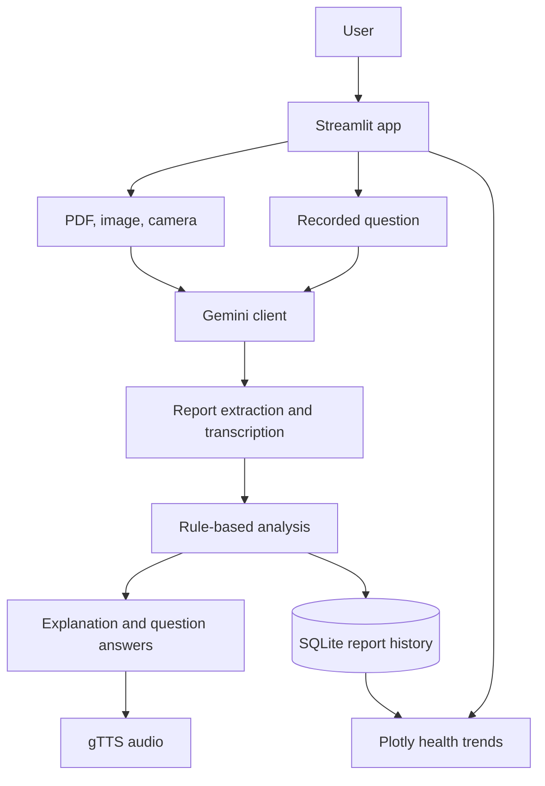

# MediLens

Medical-AI

MediLens is a college mini project that helps people understand medical lab
reports in simple language. It accepts report PDFs and images, can answer
questions by text or recorded audio, and can read explanations aloud. It also
saves results locally and charts changes across reports.

> **Important:** MediLens is an educational aid, not a diagnostic tool or a
> substitute for a doctor. Always review medical results with a qualified
> healthcare professional.

## Problem statement

Lab reports often contain technical names, units, and reference ranges that
are difficult to interpret. MediLens brings multimodal input, rule-based
range checks, and multilingual explanations together in one small application
so users can prepare informed questions for their clinician.

## Features

| Feature | Modality / technology | What it does |
|---|---|---|
| Report extraction | PDF and image | Reads report text, values, units, dates, and ranges with Gemini |
| Camera capture | Image | Takes a report photo directly in the app |
| Plain-language explanation | Text | Explains results with safety-focused prompts |
| Ask a question | Text | Answers using the currently analyzed report only |
| Voice question | Audio | Transcribes English or Indian-language speech before answering |
| Listen to explanation | Audio | Reads answers aloud using gTTS |
| Patient history | SQLite | Stores report metadata and test results locally |
| Health trends | Plotly chart | Shows tests across saved reports and reference ranges |
| Rule-based flags | Python | Independently checks numeric values against extracted ranges |
| Evaluation | JSON ground truth | Measures test recall, numeric value accuracy, and status accuracy |

Supported explanation and speech languages: English, Hindi, Kannada, Tamil,
Telugu, Malayalam, Marathi, Bengali, and Gujarati.

## Architecture



## Project structure

```text
medilens/
├── app.py
├── medilens/
│   ├── __init__.py
│   ├── analysis.py
│   ├── config.py
│   ├── gemini_client.py
│   ├── prompts.py
│   ├── speech.py
│   └── storage.py
├── eval/
│   └── reports/
│       └── example_truth.json.sample
├── .streamlit/config.toml
├── .env.example
├── .gitignore
├── evaluate.py
├── requirements.txt
├── seed_demo.py
└── README.md
```

## Setup

You need Python 3.10 or newer and a Gemini API key. Model extraction,
explanations, and transcription require an internet connection and Gemini API
access. gTTS also requires an internet connection.

### Windows (PowerShell)

```powershell
cd path\to\medilens
py -3.10 -m venv .venv
.\.venv\Scripts\Activate.ps1
python -m pip install -r requirements.txt
Copy-Item .env.example .env
```

Open `.env` and replace `your_gemini_api_key_here` with your Gemini API key.
Then run:

```powershell
streamlit run app.py
```

If PowerShell blocks activation, use `.\.venv\Scripts\python.exe` instead of
activating the environment.

### macOS / Linux

```bash
cd path/to/medilens
python3 -m venv .venv
source .venv/bin/activate
python -m pip install -r requirements.txt
cp .env.example .env
```

Edit `.env` and add your Gemini API key, then start the app:

```bash
streamlit run app.py
```

Available configuration variables:

| Variable | Default | Description |
|---|---|---|
| `GEMINI_API_KEY` | (required for AI features) | Google Gemini API key |
| `GEMINI_MODEL` | `gemini-2.5-flash` | Gemini model name |
| `DB_PATH` | `data/medilens.db` | SQLite database file path |

## Demo data

Seed three invented reports (January, May, and October 2026) without calling
the API:

```bash
python seed_demo.py
```

In the app, set **Patient profile** to `Demo Patient` and open **Health
trends**. Running the seed script again skips dates already inserted.

## Extraction evaluation

Place a report in `eval/reports/` and create a same-named `.json` file beside
it. For example, `sample.pdf` should have `sample.json` with this shape:

```json
{
  "tests": [
    {
      "standard_name": "Fasting Blood Glucose",
      "value": 96,
      "status": "normal"
    }
  ]
}
```

The supplied `example_truth.json.sample` is a template; copy it to a matching
`.json` file and update it for a real evaluation report. Run:

```bash
python evaluate.py
```

The script writes per-test comparisons, per-report metrics, and overall
metrics to `eval/results.csv`. Test names are matched case-insensitively after
punctuation is removed. Numeric value accuracy uses an absolute tolerance of
`0.01`; status accuracy requires an exact status match.

## Limitations and privacy

- Blurry, rotated, cropped, or low-resolution photos may cause extraction
  errors. Review every extracted value against the original report.
- Test names and reference ranges vary between laboratories. A similar name
  does not guarantee that two tests or ranges are equivalent.
- Gemini can misread reports or generate incomplete explanations. Rule-based
  checks only verify numeric results against extracted ranges; they do not
  establish medical meaning.
- gTTS and Gemini features need internet access. Gemini API use may incur
  charges or rate limits according to your account.
- The SQLite database is local to the app, but uploaded files and report
  content are sent to Gemini for processing. Do not upload sensitive records
  unless you understand and accept the service's privacy terms. Keep `.env`
  private and do not commit it.

## Tech stack

Python 3.10+, Streamlit, Google Gemini via the official `google-genai`
package, gTTS, SQLite, Pandas, Plotly, and python-dotenv.
